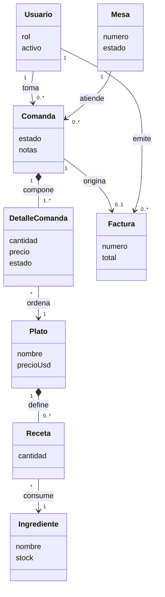
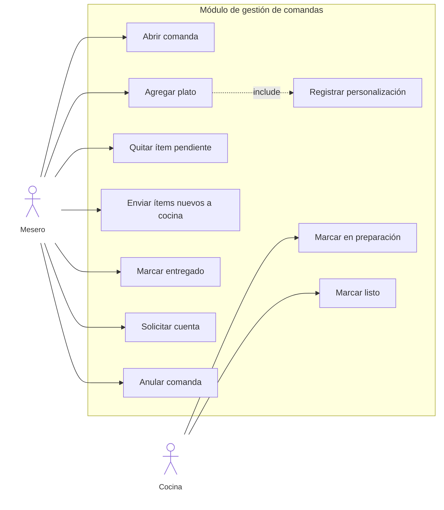
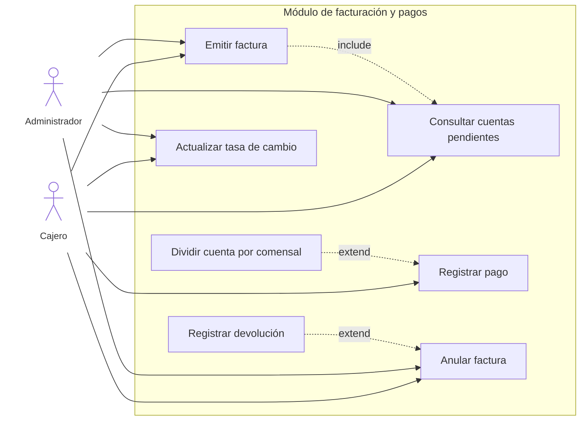
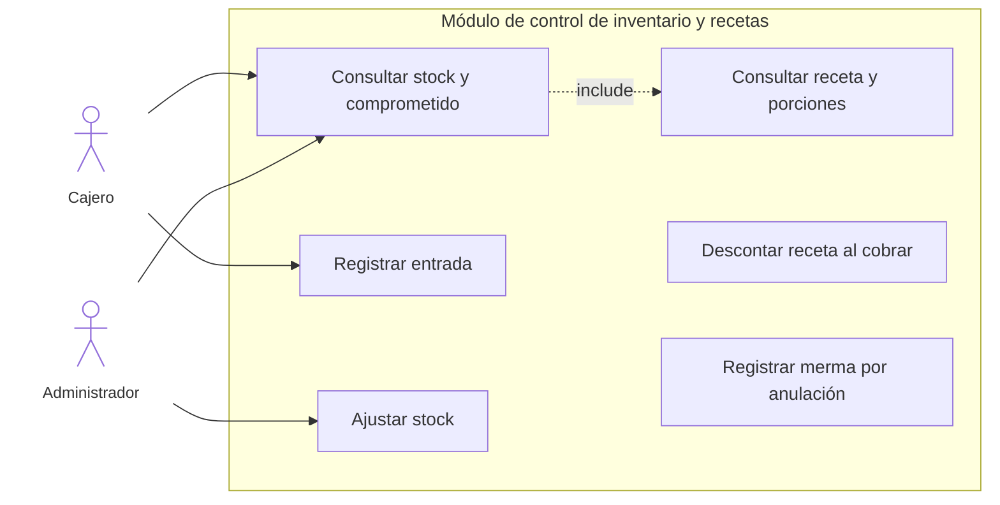
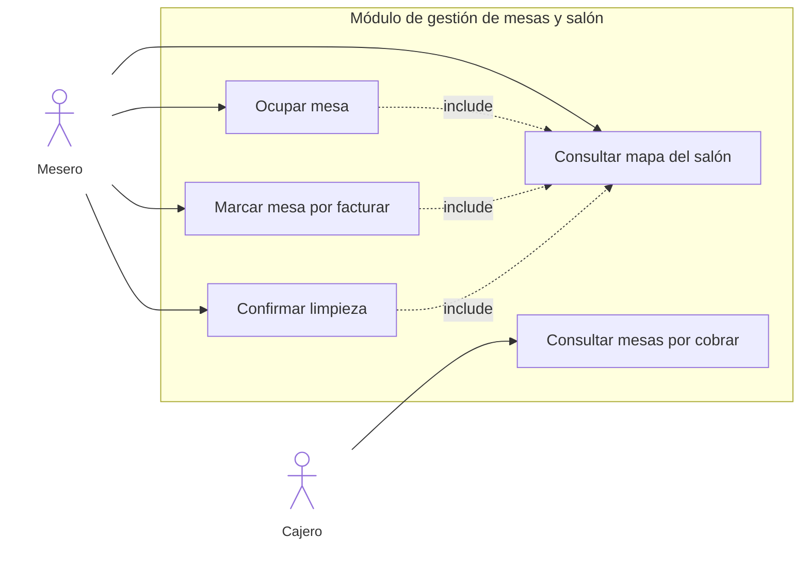
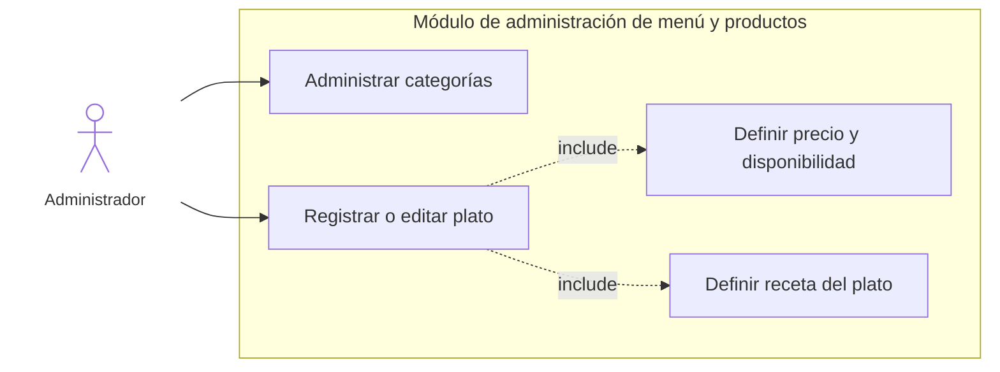
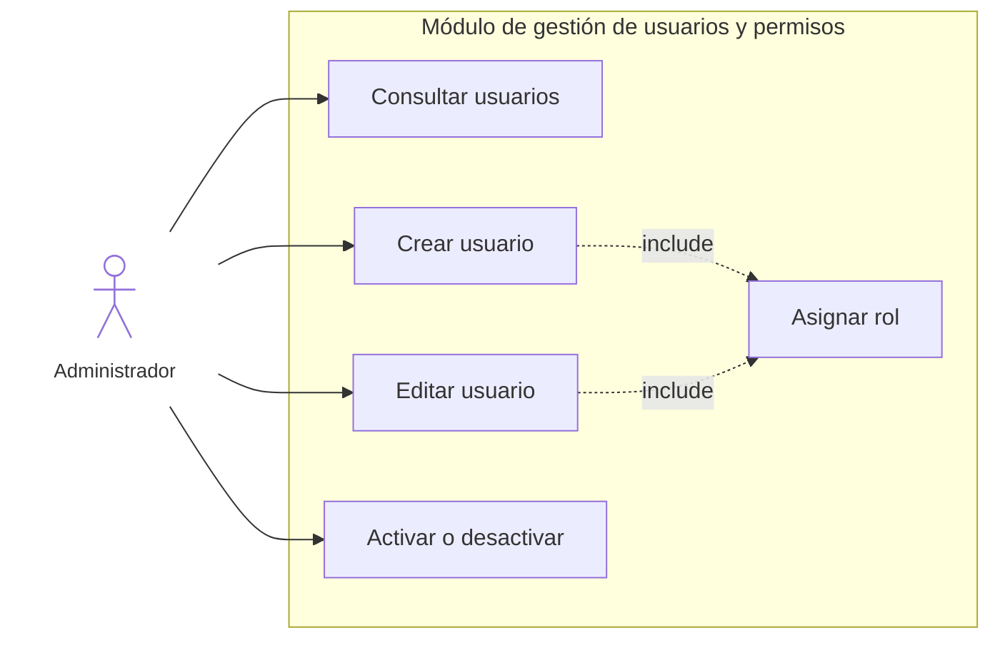
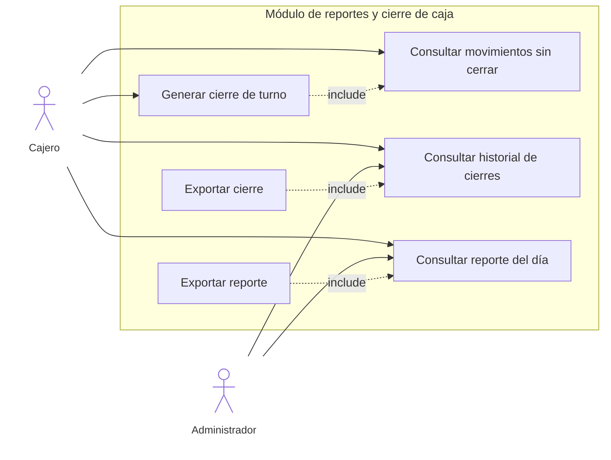
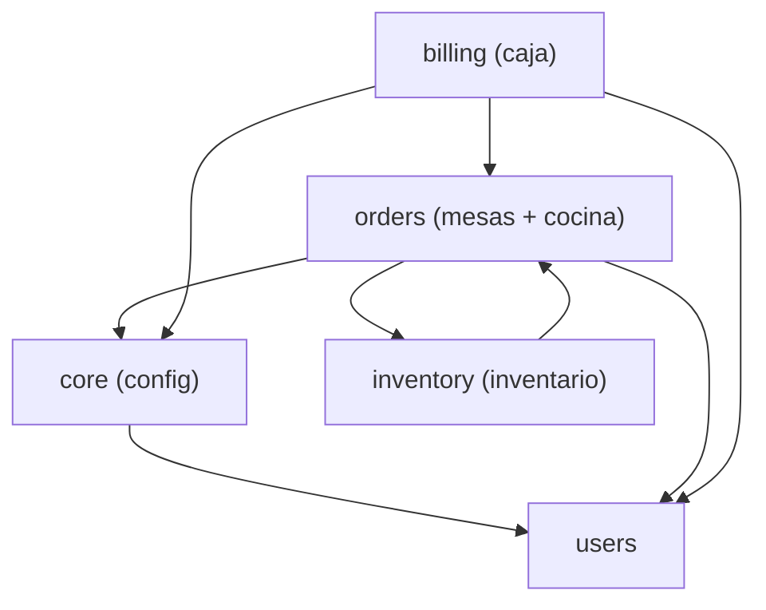
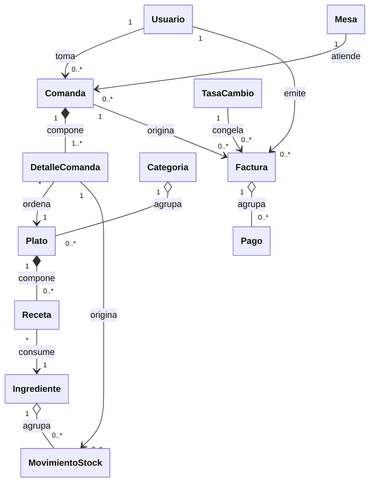

# 4.2 Fase de Elaboración

La Fase de Elaboración precisa la arquitectura candidata del sistema de gestión operativa y comercial de **Comida Árabe El Amir** y especifica los casos de uso que sostienen el ciclo de servicio: toma de la comanda en sala, preparación en cocina, cobro en caja y descargo de materias primas. El análisis se expresa en el vocabulario del negocio y se traza, cuando corresponde, hacia el modelo implementado en Django, de modo que la memoria descriptiva y el software describan el mismo sistema.

La correspondencia entre el concepto de negocio y la clase persistente es la siguiente.

| Concepto de negocio | Clase Django | Aplicación |
| --- | --- | --- |
| Usuario | `User` (grupos de rol) | `django.contrib.auth` / `config` |
| Mesa | `Mesa` | `mesas` |
| Comanda | `Pedido` | `mesas` |
| Detalle de comanda | `DetallePedido` | `mesas` |
| Plato | `Producto` | `inventario` |
| Receta | `Receta` | `inventario` |
| Ingrediente | `Insumo` | `inventario` |
| Factura | `Factura` | `caja` |

## 4.2.1 Modelo de Dominio

El dominio del restaurante se organiza alrededor de la mesa como unidad de atención y de la comanda como unidad de servicio. Un **usuario** autenticado actúa según un rol (mesero, cocinero, cajero o administrador) y deja constancia de quién tomó la comanda y quién emitió la factura. La **mesa** posee número, capacidad y un estado de sala: disponible, ocupada, por facturar o por limpiar. Ese estado no es un dato decorativo: gobierna si puede abrirse un nuevo servicio, si caja puede cobrar y si el salón puede volver a sentar comensales.

La **comanda** vincula una mesa con el mesero responsable. Nace abierta, admite ítems sucesivos y se cierra cuando la cuenta queda saldada o cuando se anula. Cada **detalle de comanda** representa un plato pedido: cantidad, precio unitario congelado en bolívares al momento de agregarlo, observación de personalización y estado de preparación. El precio se congela para que un cambio posterior de la tasa de cambio no altere lo ya ordenado.

El **plato** es el producto de carta. Se clasifica en una categoría, tiene precio de venta en dólares y se ofrece solo si está marcado como disponible y si la receta todavía alcanza con el stock libre. La **receta** es la lista de materiales del plato: por cada unidad vendida indica qué **ingrediente** se consume y en qué cantidad. El ingrediente (insumo) conserva stock actual, stock mínimo y unidad de medida. No es propiedad exclusiva de un plato: el mismo insumo participa en varias recetas.

La **factura** consolida los detalles vigentes de una comanda. Registra subtotal y total en moneda local, el equivalente en dólares y la tasa con la que se hizo la conversión. Una comanda admite a lo sumo una factura vigente; las anuladas permanecen como historia. El pago, la tasa de cambio, el movimiento de stock y la categoría de carta son conceptos de soporte: no sustituyen a las ocho entidades nucleares, pero explican cómo el dominio comercial y el dominio de almacén se conectan.

Las reglas de negocio que el modelo debe preservar son estas:

1. Una mesa activa tiene como máximo una comanda abierta. Las comandas cerradas o anuladas quedan como historial.
2. El detalle referencia un plato y conserva el precio de ese momento. La personalización viaja en la observación del ítem y no altera la receta estándar.
3. El estado de cada ítem avanza sin retroceso: Pendiente, En preparación, Listo y Entregado. La anulación solo es posible mientras cocina no ha comenzado, salvo decisión de un administrador sobre la comanda completa.
4. Enviar a cocina transmite únicamente los ítems nuevos. Los ya enviados no se retransmiten.
5. El stock físico no baja al enviar el plato a cocina. En ese momento el insumo queda comprometido (reservado) para no vender porciones que ya no alcanzan. El descargo real, mediante la receta, ocurre cuando la factura queda pagada. Si se anula una comanda con platos ya preparados, lo consumido se registra como merma.
6. La mesa pasa a por facturar cuando el mesero solicita la cuenta, a por limpiar cuando el cobro se completa, y a disponible cuando el personal de sala confirma la limpieza.
7. El total de la factura coincide con el subtotal de los ítems vigentes. El precio de carta es un precio de venta final en dólares, convertido a bolívares con la tasa vigente; el sistema no agrega una alícuota impositiva desglosada. La tasa usada queda congelada en la factura.

**Figura.** Modelo conceptual de dominio de Comida Árabe El Amir.

La composición entre comanda y detalle expresa que el ítem no tiene sentido fuera de su comanda. La composición entre plato y receta expresa que la línea de receta se elimina con el plato, mientras el ingrediente permanece en el almacén. La factura vigente es opcional: existe solo después de que caja consolida la cuenta. Un mismo usuario puede tomar muchas comandas y, si su rol es de caja, emitir muchas facturas; son asociaciones distintas, no un único vínculo genérico.

## 4.2.2 Diagramas de Casos de Uso

La elaboración no se resume en un solo diagrama general. Cada módulo del sistema tiene su propio límite, sus actores y sus casos de uso. Los siete módulos siguientes están presentes en la aplicación: comandas y cocina, facturación, inventario, salón, carta, usuarios y cierre. No se omite ninguno, porque cada uno tiene pantallas o reglas persistentes en el software. Cada actor se dibuja como un monigote, fuera del límite del módulo. Las flechas continuas indican quién inicia el caso. Las punteadas marcadas como `include` indican un paso que el caso origen incorpora siempre. Las marcadas como `extend` indican un comportamiento que solo ocurre en una variante.

En el módulo de inventario el actor del día a día es el cajero, que es quien consulta el stock y registra las entradas. El administrador también entra a ese módulo porque hereda los permisos de los demás roles, y es quien ajusta la ficha del insumo desde el panel de administración. La fórmula de la receta, en cambio, se mantiene en el módulo de menú.

### 4.2.2.1 Definición de Actores

Los actores son roles de negocio, no personas concretas. Una misma persona tiene un solo grupo de acceso. El administrador hereda la operación de los demás roles y, además, concentra lo que nadie más puede hacer: usuarios, carta, anulación forzada de una comanda ya en marcha y la vista consolidada de los cierres.

**Mesero / Personal de sala.** Opera el mapa y la comanda. Abre la mesa, agrega platos con cantidad y nota, retira ítems que cocina aún no empezó, envía a cocina solo lo nuevo y marca como entregado lo que ya está listo. Pide la cuenta y, después del cobro, confirma la limpieza. No factura ni modifica el stock. Solo gestiona las comandas que abrió.

**Cajero.** Emite la factura, cobra en efectivo en bolívares, pago móvil, tarjeta o divisa, divide la cuenta, anula con motivo y cierra su turno. Consulta el stock, registra entradas de mercancía y actualiza la tasa de cambio. En el salón no toma pedidos: ve las mesas que ya están por facturar y, al saldar la cuenta, las deja por limpiar. En reportes ve solo su propia caja.

**Cocina / Personal de preparación.** Usa el monitor de cocina sobre los ítems ya enviados y todavía no entregados. Los pasa a En preparación y luego a Listo. No crea comandas, no cambia precios y no cobra. El marcado Entregado lo hace el mesero, que es quien presencia la salida del plato.

**Administrador.** Crea y desactiva usuarios, asigna el rol y mantiene categorías, platos y recetas en el panel de administración. Puede ejecutar la operación de caja, sala e inventario. Ve el historial de cierres de todos los cajeros y el reporte consolidado del día. No puede quitarse el rol ni desactivar su propio usuario. Es el único que puede anular una comanda cuando ya hay platos en preparación, listos o entregados.

El cliente del restaurante no es actor del sistema. Quien traduce su pedido al software es el mesero.

### 4.2.2.2 Especificación de Casos de Uso

#### Módulo de gestión de comandas

Participan el mesero y cocina. El mesero arma la comanda y la transmite. Cocina avanza la preparación. El mesero cierra el ciclo al servir y al pedir la cuenta.

**Figura.** Casos de uso del módulo de gestión de comandas.

##### CU-COM-01 Registrar la comanda y transmitirla a cocina

| Campo | Especificación |
| --- | --- |
| **ID** | CU-COM-01 |
| **Nombre** | Registrar la comanda y transmitirla a cocina |
| **Actores** | Mesero (principal). Cocina recibe los ítems enviados. |
| **Precondiciones** | El mesero está autenticado. La mesa está activa y no está por limpiar. Si la mesa ya tiene comanda, esa comanda es suya o quien actúa es administrador. Hay tasa de cambio vigente. El plato está disponible y, si tiene receta, quedan porciones libres. |
| **Postcondiciones** | La mesa queda ocupada. La comanda queda abierta con sus detalles, cada uno con precio en bolívares congelado y estado Pendiente. Los ítems enviados quedan en la cola de cocina y los insumos quedan comprometidos, sin bajar todavía el stock físico. |

**Flujo principal**

1. El mesero selecciona la mesa en el mapa.
2. El sistema abre la comanda, la asocia al mesero y marca la mesa como ocupada. Si ya existía, la recupera.
3. El mesero elige plato, cantidad y, si hace falta, la nota de personalización.
4. El sistema valida cantidad, disponibilidad y porciones, congela el precio y agrega el detalle en Pendiente, sin enviarlo.
5. El mesero repite el alta para el resto de la orden.
6. El mesero envía a cocina. El sistema marca solo los ítems nuevos, registra la hora y pasa la comanda a Enviado a cocina.

**Flujos alternativos**

- **FA-COM-01.1** Mesa por limpiar: no se abre comanda.
- **FA-COM-01.2** La comanda es de otro mesero: se niega el acceso.
- **FA-COM-01.3** No hay tasa, el plato está agotado o la cantidad supera las porciones: el ítem no se agrega.
- **FA-COM-01.4** No hay ítems nuevos: el envío se rechaza y no se duplica lo ya transmitido.
- **FA-COM-01.5** El mesero quita un ítem Pendiente. Si no se había enviado, se elimina. Si ya se envió y cocina no lo empezó, queda anulado. Si ya está en preparación, listo o entregado, el retiro se rechaza.
- **FA-COM-01.6** Hay factura vigente: no se agregan, quitan ni envían ítems.

##### CU-COM-02 Avanzar la preparación y servir

| Campo | Especificación |
| --- | --- |
| **ID** | CU-COM-02 |
| **Nombre** | Avanzar la preparación y servir |
| **Actores** | Cocina (principal en preparación y listo). Mesero (principal al marcar entregado y al solicitar la cuenta). |
| **Precondiciones** | El ítem fue enviado a cocina y no está anulado ni entregado. Quien cambia a En preparación o Listo pertenece a cocina. Quien marca Entregado o pide la cuenta es el mesero de esa comanda, o el administrador. |
| **Postcondiciones** | El ítem queda en el estado indicado, sin retroceso. El estado de la comanda se recalcula desde sus ítems. Si se solicitó la cuenta y no quedan ítems sin enviar, la mesa pasa a por facturar. |

**Flujo principal**

1. Cocina ve la cola ordenada del envío más antiguo al más reciente, con alerta de demora o de nivel crítico según el tiempo de espera.
2. Marca el ítem como En preparación. El sistema solo acepta el cambio si estaba Pendiente y ya enviado.
3. Al terminar, cocina lo marca Listo. El sistema solo acepta el cambio si estaba En preparación.
4. El mesero, al llevar el plato a la mesa, lo marca Entregado. El sistema solo acepta el cambio si estaba Listo.
5. Cuando el comensal pide la cuenta, el mesero solicita el cobro. Si todo lo vigente ya fue enviado, la mesa pasa a por facturar.

**Flujos alternativos**

- **FA-COM-02.1** La acción no corresponde al estado actual, o el ítem no fue enviado: la transición se rechaza.
- **FA-COM-02.2** Al pasar a En preparación, si el disponible del insumo no cubre lo pedido o está en el mínimo, cocina recibe una alerta. La preparación no se detiene.
- **FA-COM-02.3** Solicitar la cuenta con ítems sin enviar: se rechaza hasta que se envíen o se quiten.
- **FA-COM-02.4** Anulación. El mesero anula la comanda si ningún ítem salió de Pendiente y no hay factura vigente: la comanda queda anulada y la mesa disponible. Si ya hay ítems en marcha, solo el administrador puede forzarla, y lo preparado se registra como merma.

#### Módulo de facturación y pagos

El cajero es quien cobra. El administrador puede ejecutar las mismas operaciones de caja y es quien respalda las anulaciones cuando la cuenta ya tiene pagos. La tasa de cambio vive en este módulo porque sin ella no hay precio en bolívares ni factura.

**Figura.** Casos de uso del módulo de facturación y pagos.

Emitir la factura siempre parte de las cuentas pendientes. Dividir la cuenta extiende el pago solo cuando el cajero reparte platos entre comensales. La devolución extiende la anulación solo cuando la factura ya tiene pagos.

##### CU-FAC-01 Emitir la factura y registrar el pago

| Campo | Especificación |
| --- | --- |
| **ID** | CU-FAC-01 |
| **Nombre** | Emitir la factura y registrar el pago |
| **Actores** | Cajero (principal). Administrador (puede emitir y cobrar). Mesero (dejó la mesa por facturar). |
| **Precondiciones** | El usuario pertenece a caja o es administrador. La comanda no está cerrada ni anulada, tiene ítems vigentes, todos fueron enviados a cocina y no tiene otra factura vigente. Hay tasa de cambio activa. |
| **Postcondiciones** | Existe una factura con número único, subtotal, total en bolívares, total en dólares y tasa congelada. El total coincide con el subtotal: el precio de carta ya es el precio de venta y no se agrega una alícuota aparte. Si los pagos cubren el saldo, la factura queda pagada, la comanda cerrada, la mesa por limpiar y se dispara el descargo de inventario. Si el pago es parcial, la factura sigue abierta. |

**Flujo principal**

1. El cajero abre las cuentas pendientes.
2. Emite la factura. El sistema suma los detalles vigentes, congela la tasa y asigna el número correlativo.
3. Si la mesa se divide, asigna cantidades de cada plato a un comensal y obtiene el subtotal de cada uno.
4. Registra el pago: efectivo en bolívares, pago móvil, tarjeta o divisa en dólares. Pago móvil y tarjeta exigen referencia.
5. El sistema convierte la divisa a bolívares, aplica el monto al saldo y calcula vuelto solo en efectivo y divisa.
6. Con saldo cero, marca la factura pagada, cierra la comanda, pasa la mesa a por limpiar y descuenta las recetas aún no descargadas.

**Flujos alternativos**

- **FA-FAC-01.1** La comanda no es facturable: se rechaza la emisión y no se consume número.
- **FA-FAC-01.2** Pago parcial: queda registrado y la factura sigue abierta. No se cierra la mesa ni se descuenta inventario.
- **FA-FAC-01.3** Monto inválido, método desconocido o falta de referencia: ese pago se rechaza.
- **FA-FAC-01.4** Pago móvil o tarjeta por encima del saldo: se rechaza, porque esos métodos no entregan vuelto.
- **FA-FAC-01.5** El cajero publica una tasa nueva. La anterior deja de estar activa. Lo ya cobrado conserva la tasa congelada.

##### CU-FAC-02 Anular la factura

| Campo | Especificación |
| --- | --- |
| **ID** | CU-FAC-02 |
| **Nombre** | Anular la factura |
| **Actores** | Cajero (principal). Administrador (mismo alcance sobre caja). |
| **Precondiciones** | Hay una factura que no está anulada. El usuario pertenece a caja o es administrador. Si se devuelven pagos, cada pago original sigue asociado a la factura. |
| **Postcondiciones** | La factura queda anulada, con motivo, fecha y usuario cuando hay devolución. Sin pagos, la mesa vuelve a ocupada y la comanda puede editarse y facturarse de nuevo. Con la factura ya pagada, el dinero se devuelve, la comanda sigue cerrada, la mesa no se reabre y el inventario no se repone. |

**Flujo principal**

1. El cajero indica el motivo de la anulación.
2. Si la factura está abierta y no tiene pagos, el sistema la anula y devuelve la mesa a ocupada.
3. Si tiene pagos, genera una devolución por cada pago aplicado, por el monto que se había abonado a la cuenta, y anula la factura.

**Flujos alternativos**

- **FA-FAC-02.1** Falta el motivo: no se anula.
- **FA-FAC-02.2** La factura ya estaba anulada: la operación se rechaza.
- **FA-FAC-02.3** Había solo pagos parciales y la factura seguía abierta: se devuelven y la comanda vuelve a ser facturable.

#### Módulo de control de inventario y recetas

El cajero consulta existencias, ve cuántas porciones alcanza cada receta y registra la entrada de mercancía. El descargo no tiene pantalla propia: ocurre al saldar la factura. El administrador registra el ajuste cuando corrige el stock desde la ficha del insumo. La definición de la receta (qué insumo y cuánto lleva el plato) pertenece al módulo de menú.

**Figura.** Casos de uso del módulo de control de inventario y recetas.

`Descontar receta al cobrar` y `Registrar merma por anulación` no los abre el usuario en una pantalla de almacén. Los dispara, respectivamente, el pago completo de la factura y la anulación forzada de una comanda ya preparada. Quedan dentro de este límite porque modifican el stock y dejan el movimiento.

##### CU-INV-01 Consultar existencias y reponer insumos

| Campo | Especificación |
| --- | --- |
| **ID** | CU-INV-01 |
| **Nombre** | Consultar existencias y reponer insumos |
| **Actores** | Cajero (principal). Administrador (consulta y ajuste de ficha). |
| **Precondiciones** | El usuario pertenece a caja o es administrador. Los ingredientes activos tienen unidad, stock actual y stock mínimo. |
| **Postcondiciones** | La consulta muestra stock actual, comprometido por comandas abiertas, disponible y si el insumo está crítico. Una entrada suma el stock y deja un movimiento de tipo Entrada con el stock resultante. Un ajuste manual deja un movimiento de tipo Ajuste con el antes y el después. |

**Flujo principal**

1. El cajero abre el inventario. El sistema ordena primero los insumos críticos.
2. Por cada insumo calcula comprometido (receta por cantidad de los ítems aún no descargados) y disponible (stock actual menos comprometido).
3. Muestra, junto a cada plato disponible, las porciones que todavía se pueden vender según su receta.
4. El cajero elige un insumo activo, indica una cantidad mayor que cero y una nota, y registra la entrada.
5. El sistema suma el stock y guarda el movimiento.

**Flujos alternativos**

- **FA-INV-01.1** Cantidad vacía, no numérica, menor o igual a cero, o insumo inactivo: la entrada se rechaza.
- **FA-INV-01.2** El plato no tiene receta: no limita porciones y no aparece como agotado por insumos. La fórmula debe completarse en el módulo de menú.
- **FA-INV-01.3** El administrador corrige `stock actual` en la ficha. El sistema no sustituye el número en silencio: registra el ajuste con el usuario y los dos valores.

##### CU-INV-02 Descontar la receta al concretar la venta

| Campo | Especificación |
| --- | --- |
| **ID** | CU-INV-02 |
| **Nombre** | Descontar la receta al concretar la venta |
| **Actores** | Cajero, de forma indirecta, al saldar la factura. Administrador, cuando la merma nace de una anulación forzada. |
| **Precondiciones** | La factura acaba de quedar pagada, o un administrador anula una comanda con ítems ya preparados. El detalle todavía no tiene la marca de insumos descargados. El plato tiene líneas de receta. |
| **Postcondiciones** | Cada ingrediente de la receta bajó en proporción a las porciones, o quedó en cero si no alcanzaba. Existe un movimiento de salida ligado al detalle. El detalle queda marcado y no se vuelve a descontar. |

**Flujo principal**

1. Al cerrarse el pago, el sistema recorre los detalles vigentes aún no descargados.
2. Por cada línea de receta multiplica la cantidad de la fórmula por las porciones pedidas.
3. Resta del insumo lo requerido, o lo que haya si el stock no alcanza, y anota el faltante.
4. Guarda el movimiento de salida y marca el detalle como descargado.

**Flujos alternativos**

- **FA-INV-02.1** El detalle ya estaba descargado: no hay un segundo movimiento.
- **FA-INV-02.2** El plato no tiene receta: no hay salida de inventario.
- **FA-INV-02.3** Anulación con platos ya preparados: el descargo se registra como merma aunque no exista factura pagada. Lo que cocina no empezó no consume stock.
- **FA-INV-02.4** Varios platos comparten insumo: el disponible sale de un solo stock. Si ese insumo se agota, se bloquean todos los platos que lo usan.

#### Módulo de gestión de mesas y salón

Este módulo cubre el estado de la mesa, no el contenido de la comanda. El mesero ocupa, pide la cuenta y libera. El cajero consulta qué mesas están listas para cobro; al saldar la factura, la mesa pasa a por limpiar.

**Figura.** Casos de uso del módulo de gestión de mesas y salón.

##### CU-MES-01 Gestionar el estado de la mesa

| Campo | Especificación |
| --- | --- |
| **ID** | CU-MES-01 |
| **Nombre** | Gestionar el estado de la mesa |
| **Actores** | Mesero (principal). Cajero (consulta las mesas por facturar y, al cobrar, las deja por limpiar). |
| **Precondiciones** | El mesero está autenticado para el mapa y los cambios de sala. El cajero está autenticado para ver las cuentas. La mesa está activa. El alta y la baja de mesas del plano no forman parte de este caso: la disposición del salón se carga como dato del local. |
| **Postcondiciones** | La mesa queda en uno de cuatro estados: Disponible, Ocupada, Por facturar o Por limpiar. Solo una comanda abierta corresponde a esa mesa. Una mesa por limpiar no admite otro comensal hasta que sala confirme la limpieza. |

**Flujo principal**

1. El mesero consulta el mapa con el estado y, si la mesa está ocupada o por facturar, la comanda activa.
2. Al sentar clientes en una mesa disponible, el sistema la marca ocupada y abre la comanda (CU-COM-01).
3. Cuando piden la cuenta, el mesero la marca por facturar.
4. El cajero ve esa mesa entre las cuentas pendientes y, al saldarla (CU-FAC-01), el sistema la pasa a por limpiar.
5. El mesero confirma la limpieza y la mesa vuelve a disponible.

**Flujos alternativos**

- **FA-MES-01.1** Intentar ocupar una mesa por limpiar: se rechaza.
- **FA-MES-01.2** Confirmar limpieza si la mesa no está por limpiar: se rechaza y el estado no cambia.
- **FA-MES-01.3** Pedir la cuenta con ítems sin enviar a cocina: la mesa no pasa a por facturar.
- **FA-MES-01.4** Anular la factura antes de cobrar: la mesa vuelve de por facturar a ocupada.

#### Módulo de administración de menú y productos

El administrador mantiene la carta en el panel de administración: categoría, plato, precio en dólares, disponibilidad y receta. No hay una pantalla de carta dentro de la operación de sala o de caja. El mesero solo consulta los platos disponibles al armar la comanda.

**Figura.** Casos de uso del módulo de administración de menú y productos.

##### CU-MEN-01 Administrar platos y recetas

| Campo | Especificación |
| --- | --- |
| **ID** | CU-MEN-01 |
| **Nombre** | Administrar platos y recetas |
| **Actores** | Administrador. |
| **Precondiciones** | El usuario es administrador. La categoría del plato existe. Cada insumo de la receta ya está dado de alta. El precio se expresa en dólares, con valor mayor o igual a cero. |
| **Postcondiciones** | El plato queda asociado a una categoría, con precio en dólares y marca de disponibilidad. Cada línea de receta indica un insumo y la cantidad por porción, sin repetir el mismo insumo en el mismo plato. Los platos no disponibles dejan de ofrecerse en la comanda. El precio en bolívares de las comandas ya abiertas no se recalcula. |

**Flujo principal**

1. El administrador crea o elige la categoría y la deja activa.
2. Registra el plato: nombre, descripción, categoría, precio en dólares y disponibilidad.
3. Carga la receta: por cada insumo, la cantidad que consume una porción.
4. Guarda. A partir de ese momento la sala ofrece el plato si está disponible y la receta alcanza.

**Flujos alternativos**

- **FA-MEN-01.1** Ya existe ese nombre en la misma categoría: no se duplica el plato.
- **FA-MEN-01.2** La misma receta intenta repetir un insumo: la línea se rechaza.
- **FA-MEN-01.3** Cantidad de receta menor o igual a cero: la línea se rechaza.
- **FA-MEN-01.4** El plato se marca no disponible, o la categoría se desactiva: desaparece de la comanda. Las comandas ya tomadas conservan el ítem y su precio congelado.
- **FA-MEN-01.5** El plato queda sin receta: se puede vender sin tope de porciones y no descuenta inventario hasta que la fórmula exista.

#### Módulo de gestión de usuarios y permisos

Solo el administrador administra cuentas. Los roles posibles son administrador, cajero, mesero y cocinero. Cada usuario tiene un único rol.

**Figura.** Casos de uso del módulo de gestión de usuarios y permisos.

##### CU-USU-01 Administrar usuarios y roles

| Campo | Especificación |
| --- | --- |
| **ID** | CU-USU-01 |
| **Nombre** | Administrar usuarios y roles |
| **Actores** | Administrador. |
| **Precondiciones** | El actor está autenticado como administrador. El nombre de usuario no está vacío. En el alta, la contraseña cumple las reglas de longitud y no se parece al nombre ni es una clave trivial. |
| **Postcondiciones** | El usuario queda con un solo grupo, coincidente con el rol elegido. Si el rol es administrador, la cuenta queda habilitada para el panel de administración. Si se desactiva, no puede iniciar sesión. El historial de comandas y facturas de ese usuario se conserva. |

**Flujo principal**

1. El administrador consulta la lista de usuarios y el rol de cada uno.
2. Crea la cuenta con nombre de acceso, nombre, contraseña, rol y estado activo.
3. El sistema guarda la contraseña de forma no reversible y asigna exactamente ese grupo.
4. Más adelante puede editar el nombre, cambiar el rol, renovar la contraseña o invertir el estado activo.

**Flujos alternativos**

- **FA-USU-01.1** El nombre de acceso ya existe, o falta la contraseña en el alta: no se crea la cuenta.
- **FA-USU-01.2** El administrador intenta desactivarse o quitarse el rol a sí mismo: la operación se rechaza.
- **FA-USU-01.3** Al editar, si no se escribe una contraseña nueva, la anterior se mantiene.
- **FA-USU-01.4** Un usuario que no es administrador abre la lista, el alta o la edición: el sistema responde con acceso denegado.

#### Módulo de reportes y cierre de caja

El cajero cierra su propio turno y consulta su reporte. El administrador ve todos los cierres y el reporte consolidado del día. Ambos pueden exportar a CSV.

**Figura.** Casos de uso del módulo de reportes y cierre de caja.

##### CU-REP-01 Generar el cierre de caja

| Campo | Especificación |
| --- | --- |
| **ID** | CU-REP-01 |
| **Nombre** | Generar el cierre de caja |
| **Actores** | Cajero (principal). Administrador (consulta el historial de todos los cajeros y el detalle de cualquier cierre). |
| **Precondiciones** | El usuario pertenece a caja o es administrador. El cierre toma los movimientos posteriores al último cierre de ese cajero, o todos si nunca cerró. Hay tasa vigente al momento de guardar el cierre. |
| **Postcondiciones** | Queda un cierre con fecha, cajero, intervalo, tasa, totales en bolívares y dólares, cantidad de facturas, facturas anuladas y el desglose por método. El cajero solo abre sus cierres. El administrador abre cualquiera. El CSV reproduce ese mismo corte. |

**Flujo principal**

1. El cajero consulta lo acumulado desde su cierre anterior: pagos, vueltos, devoluciones, facturas cobradas y anuladas, efectivo neto y divisas.
2. Confirma el cierre. El sistema lo guarda solo si hay pagos, facturas, anulaciones o devoluciones nuevas.
3. Presenta el detalle del corte.
4. Si lo necesita, exporta ese cierre a CSV.

**Flujos alternativos**

- **FA-REP-01.1** No hay movimientos nuevos: el cierre se rechaza y no se crea un registro vacío.
- **FA-REP-01.2** Hay facturas abiertas del cajero: el cierre puede generarse, y la pantalla las informa para que no queden cuentas sin cobrar fuera del corte siguiente.
- **FA-REP-01.3** Un cajero intenta abrir el cierre de otro: acceso denegado. El administrador sí lo abre.
- **FA-REP-01.4** El historial del cajero muestra solo los suyos. El del administrador muestra los de todo el personal de caja.

##### CU-REP-02 Consultar el reporte de ventas del día

| Campo | Especificación |
| --- | --- |
| **ID** | CU-REP-02 |
| **Nombre** | Consultar el reporte de ventas del día |
| **Actores** | Cajero (sus ventas). Administrador (el consolidado de todos los cajeros, o el mismo criterio de corte sobre el día elegido). |
| **Precondiciones** | El usuario pertenece a caja o es administrador. La fecha consultada es válida; si no se indica, se usa la fecha local del restaurante. |
| **Postcondiciones** | El reporte muestra, para ese día, el desglose por método y moneda, los totales netos en bolívares y dólares, vueltos y devoluciones. No modifica facturas ni stock. El CSV, si se pide, contiene el mismo corte. |

**Flujo principal**

1. El usuario elige la fecha. Si no elige, el sistema toma el día en curso.
2. El cajero obtiene solo sus cobros y devoluciones de esa fecha. El administrador obtiene el consolidado.
3. El sistema presenta líneas por método, totales y el listado de facturas del intervalo.
4. El usuario puede descargar el mismo resultado en CSV.

**Flujos alternativos**

- **FA-REP-02.1** La fecha no se interpreta: se usa el día local y se informa el corte aplicado.
- **FA-REP-02.2** El día no tiene movimientos: el reporte se muestra en cero, sin error y sin crear un cierre.
- **FA-REP-02.3** Un usuario de sala o de cocina abre el reporte: acceso denegado.
## 4.2.3 Análisis de Riesgos

La matriz cubre riesgos técnicos, operativos y de implantación observados en el contexto del restaurante: servicio en hora pico, cobranza en bolívares y dólares, personal con distinta familiaridad digital y un servidor de la propia sede. La probabilidad y el impacto se valoran en tres niveles (baja, media, alta) antes de mitigar. El impacto alto compromete el servicio del turno o la integridad del dinero o del inventario; el medio degrada la operación pero admite continuidad manual breve; el bajo se corrige sin detener el salón.

| Riesgo | Probabilidad | Impacto | Estrategia de mitigación |
| --- | --- | --- | --- |
| Caída del enlace a Internet durante el servicio, con imposibilidad de operar si el sistema dependiera de un servicio externo | Media | Alta | Desplegar la aplicación y la base de datos en un equipo de la sede y acceder por la red local (LAN). El mapa, la cocina y la caja no requieren salida a Internet para registrar comandas, facturas ni stock. |
| Resistencia al cambio del personal de sala y cocina, acostumbrado a comanda en papel | Alta | Media | Interfaz táctil de pocos pasos: mapa visual de mesas, alta de plato con nota corta y monitor de cocina con un estado siguiente por ítem. Acompañar la puesta en marcha con un turno de práctica sobre datos de demostración y roles separados, para que nadie enfrente pantallas que no usa. |
| Merma no explicada y desvío entre el stock físico y el teórico | Alta | Alta | Descargar la receta al concretar la venta, reservar lo comprometido mientras la comanda está abierta y registrar como merma lo ya preparado si la comanda se anula. Todo movimiento guarda cantidad, stock resultante y referencia. El stock crítico se calcula sobre el disponible, no solo sobre el físico. |
| Concurrencia en hora pico: dos meseros venden las últimas porciones, o dos cajeros cobran la misma cuenta | Media | Alta | Transiciones de comanda, factura y stock dentro de transacciones. Bloqueo de fila al descontar insumos y al cobrar. En producción, PostgreSQL, porque SQLite no aplica el bloqueo pesimista y dejaría una ventana de doble venta o doble cobro. |
| Tasa de cambio desactualizada, con precios en bolívares que no reflejan el dólar del día | Alta | Alta | El precio de carta vive en dólares y el bolívar se calcula con la tasa activa. Sin tasa no se agregan ítems ni se emite factura. La tasa usada se congela en cada ítem y en cada factura, de modo que un ajuste posterior no reescribe lo ya vendido. El cajero actualiza la tasa al abrir el turno. |
| Diferencia de caja por vuelto, pago parcial, cuenta dividida o devolución | Media | Alta | Cada pago guarda método, moneda, monto recibido, monto aplicado y vuelto. Pago móvil y tarjeta exigen referencia y no admiten vuelto. El cierre de turno separa efectivo neto, divisas, vueltos y devoluciones por cajero, desde el cierre anterior. |
| Venta cobrada con stock insuficiente, que oculta roturas o recetas mal cargadas | Media | Media | No se detiene el cobro de un plato ya servido: se descuenta lo existente, el stock queda en cero y la nota del movimiento declara el faltante. La revisión de esas notas y el ajuste documentado corrigen la ficha sin borrar la venta. |
| Anulación de una cuenta ya cobrada con expectativa de que el inventario "regrese" | Baja | Media | La anulación con devolución revierte el dinero y deja motivo y usuario. No repone insumos ni reabre la mesa, porque el alimento se consumió. El procedimiento queda escrito en el caso de uso para evitar un ajuste manual en sentido contrario. |
| Indisponibilidad del servidor local (corte eléctrico, falla de disco o apagado accidental) | Media | Alta | Operar en LAN con un único host conocido, copia de respaldo diaria de la base y procedimiento corto de arranque. El historial de facturas, pagos y movimientos es la fuente para reconstruir el turno si hiciera falta cerrar en contingencia. |
| Acceso indebido entre roles (un mesero cobra, cocina altera precios, un usuario desactiva al administrador) | Media | Alta | Cada vista exige el grupo correspondiente. El administrador no se concede por el mero hecho de ser usuario técnico del servidor. Un mesero solo abre sus comandas. El administrador no puede quitarse el rol ni desactivar su propio usuario. Las anulaciones excepcionales quedan restringidas a ese rol. |
| Demora de cocina invisible hasta que el comensal reclama | Media | Media | El monitor ordena por antigüedad de envío y marca demora y nivel crítico al superar los umbrales configurados (quince y veinticinco minutos). Sala y cocina miran el mismo estado del ítem, sin reimprimir comandas. |
| Recetas incompletas o unidades inconsistentes, con descargos que no representan el plato real | Media | Alta | Unicidad de ingrediente por plato, cantidad mínima de receta y unidad explícita (unidad, gramo, kilogramo, mililitro, litro). Los platos sin receta se tratan como no controlados y deben revisarse antes de la puesta en producción del menú. |
| Pérdida de trazabilidad si se corrige el stock editando el número a mano | Baja | Alta | El stock solo cambia mediante entrada, salida de venta o ajuste, cada uno con movimiento. La ficha del ingrediente no sustituye el historial. |
| Abandono del sistema en el pico del fin de semana por una pantalla lenta o confusa en el teléfono del mesero | Media | Media | Flujos cortos, actualización parcial del mapa y de la cola de cocina, y mensajes de error en el lenguaje de la operación (plato agotado, ítem sin enviar, mesa de otro mesero) en lugar de errores técnicos. |

## 4.2.4 Diagrama de Paquetes

La arquitectura modular sigue las aplicaciones Django del proyecto. En la Fase de Elaboración se nombran por su responsabilidad, y entre paréntesis se indica la aplicación que la materializa:

- **core** (`config`): configuración, sesión, permisos por grupo, conversión monetaria y utilidades transversales.
- **users**: identidad y roles, apoyada en el usuario de Django y en la administración de cuentas del propio proyecto.
- **orders** (`mesas`, y la vista de cocina en `cocina`): mapa, comanda, detalle y monitor de preparación.
- **billing** (`caja`): tasa, factura, pago, devolución, cuenta dividida y cierre.
- **inventory** (`inventario`): categoría, plato, ingrediente, receta, movimientos y reglas de disponible.

**Figura.** Diagrama de paquetes de la arquitectura modular.

Las flechas indican dependencia de compilación o de datos: el paquete origen necesita al destino. `orders` depende de `users` porque la comanda referencia al mesero, y de `inventory` porque el detalle referencia al plato y dispara el compromiso de receta. `billing` depende de `orders` porque la factura nace de una comanda y, al pagarse, le pide el descargo. `inventory` depende de `orders` en un único punto: el movimiento de salida guarda el detalle que lo originó. Esa dependencia de retorno es deliberada para la auditoría, y conviene mantenerla estrecha (una referencia opcional al ítem) para que el almacén no absorba reglas de sala. `core` no depende de los paquetes de negocio salvo en la lectura de la tasa, que es un servicio compartido de precios; el resto de los paquetes depende de `core` para permisos y arranque. `cocina` no posee tablas propias: es un paquete de presentación y consulta dentro de `orders`, especializado en la cola de ítems ya enviados.

## 4.2.5 Diagrama de Clases de Análisis

El diagrama de análisis fija la estructura que la elaboración compromete para el diseño. Las clases usan el nombre de negocio; los tipos y las operaciones corresponden al comportamiento ya definido en los casos de uso. Las relaciones distinguen composición (el todo controla el ciclo de vida de la parte), agregación (el todo agrupa partes que podrían concebirse aparte) y asociación (vínculo sin posesión). En el modelo persistente, la composición de la comanda sobre sus detalles y la del plato sobre sus líneas de receta se realizan con borrado en cascada; el resto de los vínculos protege el historial e impide borrar un plato, un ingrediente, una mesa o un usuario que ya participó en una venta.

**Figura.** Diagrama de clases de análisis de la Fase de Elaboración.

La figura muestra las clases y sus relaciones. Los atributos y las operaciones principales quedan descritos en el texto. La multiplicidad `1..*` entre comanda y detalle expresa la regla de negocio de una comanda cobrable. En el instante inmediato a la apertura la comanda puede no tener ítems; el envío a cocina y la facturación rechazan ese estado, así que el diagrama fija la estructura válida del servicio y no el borrador vacío. La factura se asocia `0..*` porque las anuladas se conservan, con la restricción de una sola factura no anulada por comanda. El pago se agrega a la factura y no se compone de ella en el sentido de borrado: un pago registrado no se elimina, se revierte con una devolución. El movimiento de stock se agrega al ingrediente y se asocia al detalle cuando la salida proviene de una venta o de una merma; una entrada de almacén puede no tener detalle.

Las operaciones relevantes para el diseño son las transiciones, no los accesores. `enviarACocina` marca solo los detalles pendientes de envío. `sincronizarEstado` deriva el estado de la comanda desde sus ítems, en el orden Entregado, Listo, En preparación, Enviado a cocina o Abierto. `marcarEnPreparacion`, `marcarListo` y `marcarEntregado` rechazan saltos y retrocesos. `emitirDesdeComanda` congela totales y tasa. `cobrar` admite pagos parciales y solo entonces invoca `descontarInventario`. `descontarInventario` recorre la receta una sola vez por detalle. Con esas operaciones, los casos de comanda, facturación e inventario quedan soportados por el mismo modelo de clases que el dominio describió en términos de negocio.
